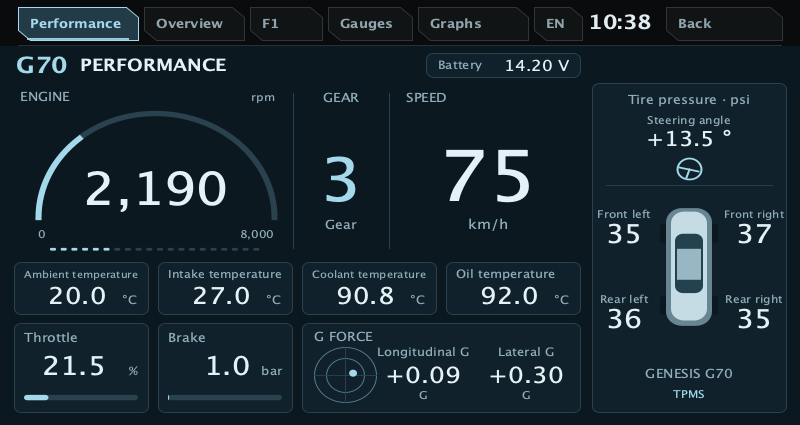

# Genesis G70 Dashboard

**English** | [한국어](README_ko.md)

A standalone dashboard for the Korean-market 2019 Genesis G70 with the Standard Gen5 head unit. The dashboard and its **G70 My Apps** launcher are available as source builds. The G70 port is at the signal-discovery stage. **G70 Probe** is the G70 APK included in this repository.

## Run the probe from a laptop

For a new checkout, use the commands below. For an existing checkout, run `git pull` in the repository.

```sh
git clone https://github.com/shariest/g70-dashboard.git
cd g70-dashboard
```

With the vehicle parked, connect one USB-debugging-enabled head unit and run the command for your laptop.

| Laptop | Command from the repository |
| --- | --- |
| Windows (PowerShell or Command Prompt, with Git for Windows) | `.\run-probe.cmd` |
| macOS, Linux or Git Bash | `./run-probe.sh` |

The launcher installs the included probe APK. If ADB is missing, it downloads Google Platform-Tools on the first run, verifies its hash and caches it locally. You can run it once before going to the car to prepare the tools while online. After checking the probe screen, press Enter on the laptop. Results are saved under `apps/g70probe/capture-*/`. [USB debugging](docs/ADB_EN.md) · [Capture guide](apps/g70probe/README.md)



## Apps

| App | Android package | Purpose |
| --- | --- | --- |
| G70 Dashboard | `com.github.shariest.g70.dashboard` | Overview, F1, gauges, graphs and Performance views. Missing or expired readings display a dash. |
| G70 My Apps | `com.github.shariest.g70.hub` | Opens the dashboard and installed apps, with optional edge-button and notification shortcuts. |
| G70 Probe | `com.github.shariest.g70.probe` | Records the head-unit build, available OEM managers and raw vehicle data for offline analysis. |

## Getting started

- **Develop the dashboard** with JDK 17. Run the host tests and build unsigned APKs for both apps. [Build and test](docs/BUILD.md)
- **Investigate G70 signals** with the vehicle parked and the intended head unit connected through ADB. [Enable USB debugging and check the connection](docs/ADB_EN.md) · [Probe guide](apps/g70probe/README.md)
- **Check installation status** before selecting an artifact. Dashboard installation, signal decoding and restoration after a full restart still need G70 vehicle evidence. [Compatibility and status](docs/STATUS.md) · [Installation guide](docs/INSTALL_EN.md)

This is a fork of Veloster N Dashboard. The original signed APKs and vehicle observations are archived with their original identities. [Release history](docs/RELEASE.md) · [Documentation](docs/README.md) · [License and attribution](NOTICE.md)
