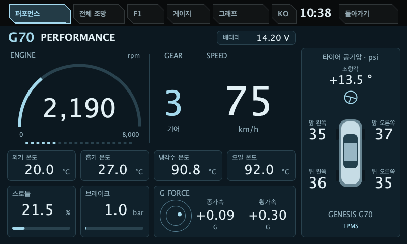

# 제네시스 G70 대시보드

[English](README.md) | **한국어**

2019년형 국내 제네시스 G70의 표준형 5세대 순정 내비게이션을 위한 독립 계기판입니다. 계기판과 앱 실행기 **G70 내 앱**을 소스에서 빌드할 수 있습니다. 현재 차량에서 어떤 신호를 받을 수 있는지 조사하는 단계이며, 저장소에 들어 있는 G70용 APK는 **G70 Probe**입니다.

## 노트북에서 Probe 실행

처음에는 아래 명령으로 저장소를 받습니다. 이미 받았다면 저장소 폴더에서 `git pull`만 실행하세요.

```sh
git clone https://github.com/shariest/g70-dashboard.git
cd g70-dashboard
```

정차한 차량에서 USB 디버깅이 켜진 헤드유닛 한 대를 연결한 뒤 실행합니다.

| 노트북 | 저장소 폴더에서 실행할 명령 |
| --- | --- |
| Windows (PowerShell 또는 명령 프롬프트, Git for Windows 설치) | `.\run-probe.cmd` |
| macOS · Linux · Git Bash | `./run-probe.sh` |

실행기는 저장소에 포함된 Probe APK를 설치합니다. 노트북에 ADB가 없으면 첫 실행 때 Google Platform-Tools를 받아 해시를 확인하고 로컬에 보관합니다. 차량에서 인터넷을 쓰기 어렵다면 출발 전에 한 번 실행해 도구를 받아 두세요. Probe 화면을 확인한 뒤 노트북에서 Enter를 누르면 결과는 `apps/g70probe/capture-*/`에 저장됩니다. [USB 디버깅 안내](docs/ADB.md) · [Probe 수집 가이드](apps/g70probe/README.md)



## 구성

| 앱 | Android 패키지 | 용도 |
| --- | --- | --- |
| G70 계기판 | `com.github.shariest.g70.dashboard` | 전체 조망, F1, 게이지, 그래프, 퍼포먼스 화면. 수신값이 없거나 만료되면 대시로 표시합니다. |
| G70 내 앱 | `com.github.shariest.g70.hub` | 계기판과 설치 앱을 엽니다. 가장자리 버튼과 알림 바로가기를 선택할 수 있습니다. |
| G70 Probe | `com.github.shariest.g70.probe` | 기기 빌드 정보와 OEM 매니저를 확인하고 차량 수신 스트림을 파일에 기록합니다. |

## 시작하기

- **계기판을 개발하려면** JDK 17로 호스트 테스트를 실행한 뒤 두 앱의 미서명 APK를 빌드합니다. [빌드·테스트](docs/BUILD.md)
- **G70의 신호를 조사하려면** 정차 상태에서 대상 헤드유닛의 ADB 연결을 확인하고 Probe를 사용합니다. [USB 디버깅 켜기·연결 확인](docs/ADB.md) · [Probe 사용법](apps/g70probe/README.md)
- **설치 가능 범위를 확인하려면** 대상 펌웨어와 산출물 목록을 확인하세요. 계기판과 내 앱의 G70 실차 설치, 신호 해석, 재시동 후 복원은 아직 확인 전입니다. [확인 범위](docs/STATUS.md#한국어) · [설치 안내](docs/INSTALL.md)

이 앱은 벨로스터 N 대시보드에서 포크했습니다. 원본 프로젝트의 서명 APK와 실차 기록은 별도로 보관합니다. [배포 이력](docs/RELEASE.md) · [전체 문서](docs/README.md) · [라이선스 및 출처](NOTICE.md)
